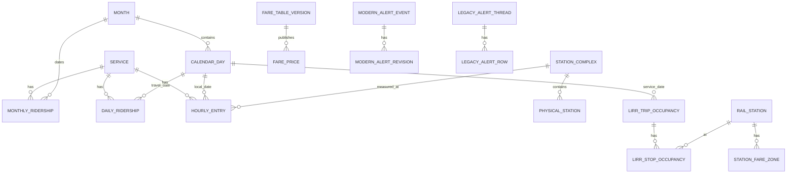

# TransitIQ — Phase 4 metrics and data model

**Status (2026-10-31): Phase 4 in progress.** This file records the data rules supported by our checks so far and the next checks we have planned. A proposed rule is not a finished pipeline or published chart.

## Read this first

For each source, we answer five questions: **What does one row mean? What identifies it? How is a metric calculated? When would that metric mislead? What belongs in Bronze, Silver and Gold?** These questions cover Phase 4's grain, references, relationships, formulas, value states and processing stages.

The [tab-wise source plan](02_data_sources_by_tab.md) says **which sources we intend to use and where**. This file says **what their rows mean and which calculations we can justify**. The [Phase 4 final review](04_phase4_final_review.md) gives the first-dashboard metric/status matrix. A source listed as needed in the plan still needs checks before its dashboard result is ready.

| Source family | Sources in the tab-wise plan | Tabs that use it | Phase 4 position |
| --- | --- | --- | --- |
| Monthly ridership | [MTA Monthly Ridership / Traffic](https://data.ny.gov/d/xfre-bxip) | Tabs 2 and 3 | Initial checks done; one estimate per service-month. |
| Daily ridership | [MTA Daily Ridership and Traffic](https://data.ny.gov/d/sayj-mze2) | Tabs 2 and 3 | Initial checks done; blank counts remain missing. |
| Hourly Subway/SIR entries | [2017–2019](https://data.ny.gov/d/t69i-h2me), [2020–2024](https://data.ny.gov/d/wujg-7c2s), [2025 onward](https://data.ny.gov/d/5wq4-mkjj) | Tabs 2 and 4; conditional Tab 1 use; selected Tab 3 highlights; later ML | Small checks done; full-period coverage and category checks remain. |
| Service alerts | [2012–2020](https://data.ny.gov/d/3h5b-5ktz), [April 2020 onward](https://data.ny.gov/d/7kct-peq7) | Tab 1 and conditional Tab 3 card | Small checks done; event grouping and duration remain conditional. |
| Reliability, on-time and Subway customer-journey performance | Four service OTP sources, Metro-North Service Reliability and Subway Customer Journey-Focused Metrics, listed below | Tabs 1 and 3 | **Initial family checks complete.** Small samples checked from all six sources; Metro-North Service Reliability has a documented August 2026 conflict. Wider pipeline checks and some units remain. |
| LIRR occupancy | [Trip-level](https://data.ny.gov/d/73th-g5ad), [stop-level](https://data.ny.gov/d/hb2b-cimm) | Tab 2 and selected Tab 3 highlights | **Initial family checks complete.** Trip/stop samples, ranges, field meanings and one join checked; pipeline quality checks remain. |
| Railroad fare policy and tables | [Fare policy](https://www.mta.info/fares-tolls/lirr-metro-north) and dated tables listed in the source plan | Tab 4 | **Initial checks complete for selected LIRR and Metro-North examples.** Version, coverage, special-ticket and recommendation checks remain before publication. |
| Station, complex, branch and calendar references | [Subway complexes](https://data.ny.gov/d/5f5g-n3cz), [physical stations](https://data.ny.gov/d/39hk-dx4f), [rail stations](https://data.ny.gov/d/wxmd-5cpm), [rail branches](https://data.ny.gov/d/2vcb-zrh4), and a defined local calendar | Filters, maps and joins across Tabs 1–4 | **In progress.** One Subway complex with two physical stations and one SIR complex with one physical station checked; broader coverage, rail branches and calendar rules remain. |

The AI assistant is a later phase. It may use validated Gold results and individually approved history documents after those sources are registered; it does not create new evidence for a metric.

## Monthly ridership

### What one row means

Source: [MTA Monthly Ridership / Traffic Data](https://data.ny.gov/d/xfre-bxip), dataset ID `xfre-bxip`.

One source row represents one published **agency's ridership estimate for one month**.

| Source field | Meaning | Data type we will use |
| --- | --- | --- |
| `month` | The month being reported | Date, stored as the first day of the month |
| `agency` | The MTA service label | Text |
| `ridership` | Published monthly ridership estimate | Decimal number; preserve fractional values |

The expected unique key is **`agency + month`**. Our checked snapshot has one row per month for Subway, SIR, LIRR and MNR from January 2019 through August 2026: 368 rows in total. That row count describes **data coverage**, not the number of riders.

### Service and month labels

| Project service | Source `agency` value | Important scope note |
| --- | --- | --- |
| NYC Subway | `Subway` | The publisher says this grouping includes SIR. Label its scope clearly; do not add the separate SIR row to it. |
| Staten Island Railway | `SIR` | Separate published SIR estimate |
| Long Island Rail Road | `LIRR` | Published LIRR estimate |
| Metro-North Railroad | `MNR` | Published Metro-North estimate |

For each month, keep `month_start`, `year` and `month_number`. We will later add station, complex, route and branch references when the sources that use them are checked. We will not invent station or route IDs for this monthly dataset: it contains no station or route detail.

### Working relationships across the checked sources

This is a **working relationship map** for sources we have examined. It shows the intended join direction and row grain; full-period key coverage and alert grouping remain to be validated in the pipelines.

`SERVICE` maps each source's service label to our four project services. `MONTHLY_RIDERSHIP` and `DAILY_RIDERSHIP` hold estimates at different time levels, so they are not interchangeable. `HOURLY_ENTRY` is measured at a fare-control complex and linked to a local calendar day; its hour remains a source value rather than a unique UTC instant. `PHYSICAL_STATION` means distinct station IDs after the repeated line rows are resolved. LIRR trip and stop occupancy use `unique_trip`; the stop-to-rail-station link uses the proposed `(railroad, stop_code)` to `(railroad, code)` mapping, which still needs a full coverage check. Modern events and legacy alert threads have separate revision tables because their IDs and timestamps have different meanings.

### Monthly calculations

| Metric | Calculation | Required comparison and display rule |
| --- | --- | --- |
| Ridership for a selected period | Sum `ridership` for **one** service over the selected published months | Show service, selected months, source and data-through date. |
| Year-over-year change | Current-period ridership minus prior-year ridership | Compare the **same months** and the same service definition. Show the absolute difference. |
| Year-over-year growth % | `(current-period ridership - prior-year ridership) / prior-year ridership × 100` | Calculate only when all matching months exist and the prior-year value is greater than zero. |
| Recovery vs. 2019 % | `selected-period ridership / ridership for the same months in 2019 × 100` | For January–August 2026, compare with **January–August 2019**, not all of 2019. Require every matching month and a 2019 denominator greater than zero. |

These monthly rows cannot tell us the busiest **day, hour, station or line**. Those questions need other sources.

### Value states

| Value state | Meaning | Display rule |
| --- | --- | --- |
| Published estimate | A number supplied by this MTA source | Label it as estimated ridership. Keep its original decimal precision in storage. |
| Zero | A published numeric value of `0` | Show zero only if the source actually supplies zero. |
| Missing | An expected source row or value is absent | Show “data unavailable”; do not replace it with zero. |
| Forecast | A later model's prediction | Label it as a forecast, with forecast time and horizon. |
| Projection | A forward-looking scenario or estimate, if one is added later | Name the method and assumptions; never label it as an observed value or silently merge it with a forecast. No projection source is selected for the first dashboard. |
| Unsupported | The source cannot answer the question | Hide the metric or explain why it is unavailable. |

### Bronze, Silver and Gold

| Stage | Responsibility for this monthly source |
| --- | --- |
| **Bronze** | Keep the bounded source extract as received, plus source link and extraction date. |
| **Silver** | Check and type the three fields; map service labels; preserve decimals; check one row per service-month and flag missing, invalid or negative values. |
| **Gold** | Publish the checked service-month measure and comparable year-over-year/2019 calculations for the dashboard. |

These are **design responsibilities**, not three copies to download now. Delta Lake and Databricks can implement this design in a later phase.

## Daily ridership

Source: [MTA Daily Ridership and Traffic](https://data.ny.gov/d/sayj-mze2), dataset ID `sayj-mze2`.

One row is one transit mode on one travel date. The unique key `mode + date` held across the checked four-mode source snapshot: a source-side duplicate-key query returned no rows.

| Field | Meaning | Rule |
| --- | --- | --- |
| `date` | Travel date | Store as a date in New York local time. |
| `mode` | Service label | Use Subway, SIR, LIRR and MNR; verify the source's service definitions. |
| `count` | Daily ridership estimate for these four modes | Keep numeric precision. A blank value is missing, not zero. |

### What we checked in the source snapshot

| Check | Result |
| --- | --- |
| Dates | 2020-03-01 through 2026-10-29, with **2,434 rows per mode**. This equals the number of calendar days in that span. |
| Row key | No duplicate `mode + date` rows across the four selected modes. Together with the row count, this gives one row per calendar day per mode in the checked snapshot. |
| Blank `count` values | **SIR: 33; Subway: 1; LIRR: 0; MNR: 0.** The remaining valid-count rows are 2,401, 2,433, 2,434 and 2,434 respectively. |
| Where blanks appeared | The Subway blank and one SIR blank are on **2026-10-29**. The other 32 SIR blanks are weekend dates: three in 2020 and 29 in 2021. Their cause is unknown. |
| Negative counts | None found for the four modes. |

The publisher can revise values later. A row with a blank count means **missing data**, not zero ridership. The observed weekend pattern does not establish why the SIR values are missing.

| Planned metric | Definition |
| --- | --- |
| Average daily ridership | Sum valid daily estimates ÷ number of days with valid estimates. Show that day count and the number of blank-count days in the selected period. Check value coverage before publishing. |
| Busiest day | Date with the highest valid daily estimate in the selected period. |
| Weekday/weekend comparison | Group valid daily estimates by the travel date's weekday or weekend status; show the number of valid days in each group. |
| Weekend ridership share | Sum valid daily estimates on calendar weekends ÷ sum valid daily estimates on all eligible observed days for the **same mode and selected dates**. Show the usable-day coverage for each day type; keep periods with biased missing weekends conditional. |

This source begins in 2020, so it does not supply 2019 daily values. Use the monthly source for a comparable 2019 recovery measure. Do not assume monthly and daily estimates will sum to exactly the same published total.

If the selected period contains a blank `count`, label the result **average of available days** and show valid days / expected days. Label the maximum **busiest observed day** rather than implying every day's ridership was known. SIR weekday/weekend comparisons over periods containing the 2020–2021 blank weekends remain **conditional** until their effect is reviewed; a complete-date subset can be used instead. For “latest available demand,” use the latest date with a non-null count **for that mode**, not merely the latest row date.

**One metric name, one source in each view:** For whole-month selections, the `Total Ridership` card in Tabs 2 and 3 uses the published **monthly** source. For an arbitrary day range, label the sum from the **daily** source as `Estimated ridership over observed days`, with valid-day coverage; do not present it as the same published monthly total. Year-over-year growth and 2019 recovery use comparable complete months from the monthly source. If a user selects a partial month or unsupported day-level period, hide those comparisons until a matching period and source are available. Tabs 2 and 3 must use the same source, unit and date scope when they display the same named metric.

Bronze keeps the source rows and extraction date. Silver checks dates, modes, numeric values, blanks and duplicate `mode + date` keys. Gold contains the checked daily measures for Tabs 2 and 3.

## Hourly fare-entry sources

Source: [MTA Subway Hourly Ridership: Beginning 2025](https://data.ny.gov/d/5wq4-mkjj), dataset ID `5wq4-mkjj`.

A small sample for 2025-04-01 returned five Subway rows and five Staten Island Railway rows. The fields shown were `transit_timestamp`, `transit_mode`, `station_complex_id`, `station_complex`, `payment_method`, `fare_class_category`, `ridership` and `transfers`. The proposed row grain is one hour × transit mode × station complex × payment method × fare class. Separate grouped queries for **SIR and Subway on 2025-04-01**, sorted by group size, each found a maximum of **one source row** for that five-field key. This establishes uniqueness for the tested day only; other dates still need checks. Keep `station_complex_id` as an alphanumeric identifier.

An aggregate check for **2025-04-01** found **88,303 Subway source rows** and **364 SIR source rows**. Every row in both groups had a `ridership` and `transfers` value. The minimum `ridership` was **1.0** and the minimum `transfers` was **0.0** in each group, so no negative values appeared on that day. This does not establish completeness or nonnegative values for other dates. A missing station-hour row is not automatically a zero; confirm the source's reporting rules before filling gaps.

### SIR location coverage we checked

| Checked period | St George, ID `501` | Tompkinsville, ID `502` | Other SIR complexes returned? |
| --- | ---: | ---: | --- |
| April 2019 (older release) | 4,130 source rows | 2,866 source rows | No |
| 2025-04-01 | 233 source rows | 131 source rows | No |
| April 2025 | 6,970 source rows | 3,600 source rows | No |
| April 2026 | 4,448 source rows | 2,306 source rows | No |

These are **counts of hour/payment/fare-class records**, not riders or entries; differences between the counts do not measure demand change. An [MTA report](https://www.mta.info/document/111531) documents fare control at these two SIR locations, including payment when entering or exiting. The checked hourly data therefore cannot support a ranking or forecast for **all** SIR stations. The remaining periods still need checking. The 2019 and 2025/2026 rows come from different source releases; keep their release IDs.

For Tabs 2 and 4, use `ridership` as the source's estimated fare-entry measure and retain `transfers` as a separate measure. The [MTA hourly data dictionary](https://data.ny.gov/api/views/wujg-7c2s/files/41d9b5bf-aeda-4a7e-b15c-a3c5f01ee345?download=true&filename=MTA_SubwayHourlyRidership_DataDictionary.pdf) defines transfers as a **subset already included in ridership**, so never add the two fields together. Do not call the measure unique passengers or a live count. The SIR fare-control rule requires a separate interpretation of its location-level values. Preserve raw payment and fare labels before mapping categories. Treat `station_complex_id` as an alphanumeric identifier. A station complex is not necessarily one physical station or one line. Do not rank lines from these rows without a defensible mapping and allocation rule. Check date coverage, nulls, uniqueness and measured station coverage before publishing hourly metrics.

| Proposed hourly metric | Calculation and display rule |
| --- | --- |
| Measured complex-hour entries | Sum valid `ridership` values across payment methods and fare classes for one mode, complex and local hour. Label as an estimate and show the data period. |
| Busiest measured complex/hour | Rank those summed entry estimates only within the selected mode, period and measured-complex coverage. Do not rank by source-row count. For SIR, identify the two measured fare-control locations explicitly. |
| Entry-analysis peak share | Sum valid `ridership` values in the confirmed local peak windows ÷ sum valid `ridership` values in **all eligible observed hours** for the same mode, measured complexes and selected dates. Show the numerator/denominator scope and coverage. This is an hourly fare-entry share, not a share of the monthly published ridership estimate. |
| OMNY share of recorded entries | OMNY `ridership` ÷ (`OMNY ridership` + `MetroCard ridership`) for the same supported mode, location and period. Check for other or missing payment methods before publishing; show the denominator. |
| Fare-class share | Sum `ridership` for a verified category ÷ sum `ridership` across comparable, classified categories in the same scope. Keep raw labels and record any category mapping across releases. |
| Transfer share, if used | Sum `transfers` ÷ sum `ridership` for the same scope. Since transfers are included in ridership, do not add them to the entry total. |

**Bronze** retains bounded source rows, source/release ID and extraction time. **Silver** validates the proposed key, local timestamps, IDs, payment/fare labels and numeric values; it records coverage and preserves raw labels. **Gold** provides measured complex-hour entries and validated fare breakdowns for Tabs 2 and 4. A later forecasting table can use checked Subway complex-hour series; SIR targets require a separate decision because the source measures only fare-control locations.

### 2019 release: checked sample

The [2017–2019 hourly release](https://data.ny.gov/d/t69i-h2me), dataset ID `t69i-h2me`, returned one bounded 2019-04-01 sample row for each selected mode: Subway at Lexington Av-53 St/51 St (complex ID `612`) and SIR at St George (ID `501`). Both samples contained the same key analytical fields as the 2025 release: local hourly timestamp, mode, complex ID/name, payment method, fare class, `ridership` and `transfers`. The sampled values were MetroCard records. The April 2019 SIR location summary appears in the table above. A separate unfiltered sample returned a Roosevelt Island Tramway row, so exclude `tram` from this four-service project. Verify category/ID comparability before combining releases.

### 2020–2024 release: checked sample

The [2020–2024 hourly release](https://data.ny.gov/d/wujg-7c2s), dataset ID `wujg-7c2s`, returned one bounded 2022-04-01 sample row per mode: Subway at 167 St (complex ID `388`, OMNY full fare) and SIR at St George (ID `501`, MetroCard other). Each row exposed timestamp, mode, complex ID/name, payment method, fare class, `ridership` and `transfers`, matching the key fields seen in the 2019 and 2025 samples. These two rows show field availability only. Keep release IDs separate and verify date coverage, measured locations, category mapping, key uniqueness and numeric quality before merging the three releases into one time series.

## Service-alert sources

| Archive | What one row means | Subway label | Candidate grouping | Current limit |
| --- | --- | --- | --- | --- |
| [2012–March 2020](https://data.ny.gov/d/3h5b-5ktz) | One archived alert record; repeated `status_id` values can have different text | `Subway` | `(agency, status_id)` for an **alert thread** | No revision number; checked repeated rows share one timestamp |
| [April 2020 onward](https://data.ny.gov/d/7kct-peq7) | One alert revision in the checked example | `NYCT Subway` | `(agency, event_id)` for a **candidate event** | An event may have many updates; end time is not verified |

The two candidate groups are **different measures**. Do not join their IDs or publish one continuous “distinct disruptions” series until their meanings and coverage are validated.

Source: [MTA Service Alerts: Beginning April 2020](https://data.ny.gov/d/7kct-peq7), dataset ID `7kct-peq7`. An unfiltered one-row sample dated 2026-08-12 had `alert_id=538085`, `event_id=262727`, `update_number=0`, `agency=BT`, `status_label=planned-work`, an affected tunnel and a short header. `BT` means Bridges & Tunnels and is excluded from our four rail services. The later agency and revision checks below refine this first sample. Preserve every raw update in Bronze.

A source-side agency grouping for **August 2026** returned `BT` (513 rows), `LIRR` (406), `MNR` (478), `NYCT Bus` (542) and `NYCT Subway` (1,396). These are **alert-update rows**, not unique events. `NYCT Subway`, `LIRR` and `MNR` are direct candidate filters for three services. No separate SIR label appeared in that month, so SIR alert coverage is **unverified**, not zero. Check whether SIR is represented under `NYCT Subway` or another field before publishing SIR disruption metrics.

A grouped August 2026 query found repeated Subway `event_id` values: `261541` had **15 alert rows** with recorded dates from 2026-08-04 06:28 through 11:56; the next four returned IDs had 13, 10, 10 and 10 rows. This confirms that one `event_id` can appear in multiple source records. Those timestamps bound the **observed updates in the selected month**, not necessarily the actual start and end of a service disruption. The 15 records for `261541` were then inspected as described below.

### Example event `261541`: what its 15 records establish

The 15 inspected `NYCT Subway` records all have `event_id=261541`. They have **15 different `alert_id` values** and `update_number` values **0 through 14**, with no missing number in this example. Two updates (`10` and `11`) share the timestamp **2026-08-04 09:51**; sort by numeric `update_number` as well as `date` when reconstructing revision order. For this source, one row is provisionally **one published alert revision**. `(agency, event_id)` is a candidate event grouping key and `alert_id` is a candidate revision identifier; check these across more events before declaring them globally unique.

The incident text describes a smoke report at Astor Place. Across revisions, `status_label` changes from `delays` to `part-suspended`, then contains several simultaneous labels (`reroute | part-suspended | delays`), and later returns to `delays`. The `affected` routes change from `4 | 6` to `2 | 3 | 4 | 5 | 6`, then narrow again. Preserve every revision. Split pipe-separated status and route fields into related child records only after preserving the original text. A service-level event total should count the event once; a route-level breakdown can count it once for **each verified affected route**, so route totals need not add up to the service total.

The final observed update, number `14` at **11:56**, still says trains are running with delays. It does **not** state that normal service resumed. Therefore the first-to-last update span is **not a verified disruption duration**. Keep duration unavailable unless a reliable start/end definition and resolution evidence are found. “Smoke” appears in the free-text header, not in a verified structured cause field; any cause or planned/unplanned classification needs documented rules and a review sample. This event alone does not validate those classifications for all events.

**Initial processing design:** Bronze stores every raw revision with source ID and extraction time. Silver types IDs and update numbers, preserves timestamps and raw text, checks candidate keys, and creates event-to-revision and event-to-affected-route relationships. Gold may publish validated event counts and route/status summaries. Duration, cause and planned/unplanned metrics stay conditional until their rules pass checks.

### Legacy 2019 alert source: checked example

The [2012–March 2020 alert archive](https://data.ny.gov/d/3h5b-5ktz), dataset ID `3h5b-5ktz`, uses different agency labels from the modern source. A grouped **April 2019** query returned `BT` (488 rows), `Bus` (1,548), `LIRR` (759), `MNR` (157) and **`Subway` (2,199)**. A query with `agency='NYCT'` returned zero because that is not the observed label in this month. No separate SIR agency label appeared; this does **not** establish zero SIR disruptions. Rows are alert records, not distinct events. The publisher says `status_id` can recur across revisions, but this source lacks modern `event_id` and `update_number`.

A grouped April 2019 Subway query found the top five `status_id` values repeated **13, 12, 11, 10 and 9** times. For each of those five groups, `min(date)` equalled `max(date)` despite the repeated rows. A compact comparison of the **13 rows** under `status_id=2DEF6C6A-8C8F-46F1-AF8E-F879553C06D2` found **1 distinct date, 2 statuses, 1 affected value, 2 headers and 12 distinct nonblank descriptions**. The rows therefore contain different content despite their shared ID and timestamp. This supports treating `status_id` as a candidate **alert-thread identifier**, not as a row identifier. Since `date` does not sequence these content changes, their order and duration remain unknown. The 13 rows are not 13 disruptions, and one thread is not yet proven to equal one disruption.

### Alert-family metric rules for the first dashboard

| Output | Phase 4 rule |
| --- | --- |
| Alert records | Count source rows only when labelled **alert records/updates**, never **disruptions**. Keep each source release and agency label distinct. |
| Distinct modern alert events | Candidate key: `(agency, event_id)` in the April 2020-onward source. Count once per key after broader uniqueness and completeness checks. Preserve child revisions by `alert_id` and `update_number`. |
| Distinct legacy alert threads | Candidate key: `(agency, status_id)` in the 2012–March 2020 source. Label **alert threads** until checks establish whether they correspond to incidents. Do not merge or compare this count directly with modern events. |
| Affected routes | Parse the pipe-separated field per revision. An event can affect several routes and the set can change; route counts may sum to more than service-level counts. |
| Status and planned/unplanned | Preserve every raw status label. Derive a category only with a documented rule and reviewed examples; multi-status revisions need an explicit policy. |
| Cause and duration | Conditional. Text mentions may support a reviewed classification, but are not a structured cause field. Neither source currently provides a verified incident end time from the examples checked. |
| SIR disruptions | Unsupported until SIR representation in the alert sources is verified. Absence of a separate SIR agency label is not a zero count. |

For the **first dashboard**, the defensible fallback is a chart explicitly labelled **published alert records** with source coverage shown. A distinct-disruption KPI remains conditional on broader event validation. In Bronze retain every raw source row; in Silver map agency labels by release and build candidate thread/event-to-revision relationships; in Gold publish only metrics whose labels match the evidence.

## Reliability, on-time and Subway customer-journey performance — initial model and checks

**Status:** The six sources below are selected in the [tab-wise source plan](02_data_sources_by_tab.md). Small samples have now been checked from all six, including four January–February 2020 rows from [Metro-North Service Reliability](https://data.ny.gov/d/sguy-yhj4). The checked rows establish initial grains and display cautions; full-period keys, coverage and some field units still need verification.

| Service | Selected source | What we want to check in a small sample | Tab 1 — Operations & Disruptions | Tab 3 — General Service Overview |
| --- | --- | --- | --- | --- |
| NYC Subway | [Subway Terminal On-Time Performance](https://data.ny.gov/d/f6rf-2a3t) | **Checked:** six April 2019 rows support the trip-count formula; source-side range is **2015-01 through 2026-09**. **Remaining:** month-by-month coverage, key and aggregation checks. | Which lines have higher or lower **terminal OTP**? Is it improving or declining? | Latest **published terminal OTP** and trend, with reporting month. |
| NYC Subway | [Subway Customer Journey-Focused Metrics](https://data.ny.gov/d/r7qk-6tcy) | **Sample checked:** month, division, line and `peak`/`offpeak`; two published fractions match the passenger count relationship. **Remaining:** wider keys/date coverage, weighting and modeled time scope. | How does **rider-journey performance** vary by supported line and period, and is it improving? | Separate Customer Journey Time Performance and extra-time highlights, with reporting month and scope. |
| SIR | [SIR On-Time Performance](https://data.ny.gov/d/fccm-griq) | **Checked:** month × `day_time`, scheduled/on-time counts, ferry-hold definitions, April 2019 time groups and **2006-01 through 2026-09 source range**. **Remaining:** month-by-month coverage and keys. | Is SIR OTP improving or declining? | Latest **published SIR OTP** and trend, with reporting month, time group and ferry-hold rule. |
| LIRR | [LIRR On-Time Performance](https://data.ny.gov/d/6kq9-5ikh) | **Checked:** separate `System Total` and `Babylon` rows with overall/period fractions; **2015-01 through 2026-09 source range**. **Remaining:** month-by-month branch coverage and candidate keys. No train-count denominator is listed. | Which branches have higher or lower OTP? Is it improving or declining? | Latest **published systemwide LIRR OTP** and separate branch trend. |
| Metro-North | [Metro-North On-Time Performance](https://data.ny.gov/d/83hw-i6xw) | **Checked:** all seven January 2020 line/territory rows and **2020-01 through 2026-09 source range**; two territory summaries had no peak fields or networkwide total row. **Remaining:** month-by-month labels/keys and any separate comparable 2019 source. | Which supported lines or territories have higher or lower OTP? Is it improving or declining? | Latest **published Metro-North OTP** and trend, with line or territory named. |
| Metro-North | [Metro-North Service Reliability](https://data.ny.gov/d/sguy-yhj4) | **Checked:** `East`/`West` sample, column descriptions and one dated row per territory-month through 2026-07; **conflicting** August 2026 duplicates. **Open:** which August values are authoritative, average-delay unit and 4–6-minute percentage scale. | Optional additional delay detail, only if its meaning and coverage fit the visual. | Number of trains more than 15 minutes late and average delay per late train, where supported. |

These sources answer **performance questions in Tabs 1 and 3**. They do not replace Tab 2 ridership or supply Tab 4 fares. The latest *published reporting month* is not a live service status. Subway terminal OTP measures **train arrivals**; Customer Journey Time Performance is an **estimated rider-trip measure**. Keep them as separate cards and trends. Do not rank unlike service definitions as one universal reliability score.

### Subway terminal OTP: first checked sample

We queried **at most six rows** for April 2019 from [source `f6rf-2a3t`](https://data.ny.gov/d/f6rf-2a3t). Lines `1`, `2` and `3` each returned one `day_type=1` row and one `day_type=2` row. The publisher's field description says **1 = weekdays** and **2 = weekends**. In this sample, each row describes one **line × month × day type**, with `division` as its line grouping. Treat `month + division + line + day_type` as a **candidate key**, pending checks across more months and lines.

| Example | On-time trips | Scheduled trips | Calculation | Published value | Display |
| --- | ---: | ---: | ---: | ---: | ---: |
| Line 1, April 2019, weekdays | 8,830 | 10,143 | `8,830 ÷ 10,143 = 0.870551119` | `0.870551119` | 87.1% |

All six sample rows matched `num_on_time_trips ÷ num_sched_trips` to the displayed source precision. The source value is a **fraction between 0 and 1**, so multiply it by 100 when formatting as a percentage. Do not multiply by 100 again during aggregation. A combined line or month rate should use `sum(on-time trips) ÷ sum(scheduled trips)` **only after** checking that the included rows represent distinct, compatible trip groups. This sample alone does not establish full-period uniqueness, completeness or the latest reporting month.

A separate source-side `min(month)`, `max(month)` and `count(*)` query returned **January 2015**, **September 2026** and **5,227 source rows** in the checked snapshot. This confirms that the selected URL contains data within the full target range of 2019–2026 and that September 2026 is its latest **recorded month in this snapshot**. It does not prove every intermediate line/month/day-type combination is present. The 5,227 rows are reporting records, not trains.

### Subway customer-journey metrics: first checked sample

We queried **at most six rows** for April 2019 from [source `r7qk-6tcy`](https://data.ny.gov/d/r7qk-6tcy). Lines `1`, `2` and `3` each returned one `peak` and one `offpeak` row. A row provisionally represents **one line × month × period**, with `division` as its line grouping. Treat `month + division + line + period` as a **candidate key**, pending wider checks. The publisher describes the passenger measures as **estimates**, so decimal values must be retained; these are not exact counts of unique people.

| Example: line 1, April 2019, off-peak | Source value | Meaning |
| --- | ---: | --- |
| `num_passengers` | 6,866,650.937 | Estimated passenger trips in this modeled group. |
| `over_five_mins` | 726,788.498 | Estimated trips exceeding the five-minute journey threshold. |
| `over_five_mins_perc` | 0.105843228 | `over_five_mins ÷ num_passengers`; display as **10.6%**. |
| `customer_journey_time` | 0.894156772 | `1 − over_five_mins_perc`; display as **89.4% Customer Journey Time Performance**. |
| `additional_platform_time` | 0.865322250 | Estimated average extra **minutes** waiting on the platform. |
| `additional_train_time` | 0.536459295 | Estimated average extra **minutes** onboard. |

In **all six checked rows**, `over_five_mins ÷ num_passengers` equaled `over_five_mins_perc`, and `over_five_mins_perc + customer_journey_time = 1`. Both performance fields are **0–1 fractions**, formatted as percentages after calculation. The extra-time fields use **minutes**, not percentages. An all-lines or combined-period customer-journey percentage would need compatible modeled groups and verified **passenger weighting**; do not average the line percentages directly. The [publisher overview](https://data.ny.gov/api/views/r7qk-6tcy/files/5cbd3068-979b-461b-a40d-56ad184c4823?download=true&filename=MTA_SubwayCustomerJourneyMetrics20152019_Overview.pdf) describes weekday 6 a.m.–11 p.m. scope for its documented period. Check applicability across the full release before offering weekend or late-night filters. This sample does not establish complete date or line coverage.

### SIR OTP: first checked sample

We retrieved **three January 2006 rows** from [source `fccm-griq`](https://data.ny.gov/d/fccm-griq). This sample is **outside** our 2019–2026 target, so it establishes fields and a sample calculation only. The rows had the same `month` and separate `day_time` values: `Weekday`, `AM Rush` and `PM Rush`. A row provisionally represents **one month × time group**; check keys and time-group definitions across the target years.

| Example: January 2006 `Weekday` | Source value | Interpretation |
| --- | ---: | --- |
| `scheduled_trips` | 2,704 | Scheduled trains in this time group. |
| `on_time_trips` / `delayed_trains` | 2,621 / 83 | Counts for the **main** OTP measure, which excludes ferry-connection holds. |
| `on_time_performance` | 0.969 | `2,621 ÷ 2,704 ≈ 0.9693`, rounded to **96.9%**. |
| `on_time_trips_with_boat` / `delayed_trains_with_boat` | 2,580 / 124 | Counts for the measure **including** ferry-related delays. |
| `on_time_performance_with` | 0.954 | `2,580 ÷ 2,704 ≈ 0.9541`, rounded to **95.4%**. |
| `incomplete_trips` / `trip_complete_percentage` | `N/A` / `N/A` | Source uses text for unavailable values in these older rows; do not turn `N/A` into zero. |

The count-to-fraction relationship also matched the other two sampled rows after rounding. The [publisher overview](https://data.ny.gov/api/views/fccm-griq/files/095afc3c-d08e-48f1-a104-c6b2b47c2965?download=true&filename=MTA_StatenIslandRailwayOTP_Overview.pdf) says the Board's main SIR OTP measure **excludes ferry-connection holds**, while a second measure includes them. We will name that choice on the card. `Weekday` may include `AM Rush` and `PM Rush`, so **do not sum these rows** without verifying that their time groups are mutually exclusive. The April 2019 sample below checks their relationship within our target period; the source's full date coverage still needs checking.

#### April 2019: checked time groups within our target years

| `day_time` | Scheduled trips | On-time trips, excluding ferry holds | Main OTP fraction | On-time trips, including ferry holds | OTP fraction including holds |
| --- | ---: | ---: | ---: | ---: | ---: |
| `7-Day` | 4,046 | 3,963 | 0.979 | 3,911 | 0.967 |
| `Weekday` | 3,278 | 3,204 | 0.977 | 3,153 | 0.962 |
| `Weekend` | 768 | 759 | 0.988 | 758 | 0.987 |
| `AM Rush` | 418 | 412 | 0.986 | 412 | 0.986 |
| `PM Rush` | 572 | 545 | 0.953 | 504 | 0.881 |

For this month, **Weekday + Weekend = 7-Day** for scheduled trips (`3,278 + 768 = 4,046`) and for both on-time counts (`3,204 + 759 = 3,963`; `3,153 + 758 = 3,911`). The rush-hour rows are narrower weekday views, so do not add them to the `Weekday` or `7-Day` rows. For a general SIR card, choose the published `7-Day` or `Weekday` row deliberately and show that label alongside the ferry-hold definition. The `7-Day` main value displays as **97.9%** (`3,963 ÷ 4,046`, rounded); including ferry holds displays as **96.7%** (`3,911 ÷ 4,046`, rounded). `incomplete_trips=9` and `trip_complete_percentage=99.8%` appeared in the `7-Day` row; the other four rows showed `N/A` for these fields. Do not treat `N/A` as zero or assume a completion rate exists for every time group. Full-period key, coverage and time-group relationships remain to be checked.

A separate source-side `min(month)`, `max(month)` and `count(*)` query returned **January 2006**, **September 2026** and **1,245 rows**. This confirms that the selected URL spans our 2019–2026 target in the checked snapshot. The total is consistent with five rows for each month across that full range, but it does **not** prove every month has exactly the five expected time groups or that candidate keys are unique; check those before publishing a complete trend.

### LIRR OTP: first checked sample

We retrieved two April 2019 rows from [source `6kq9-5ikh`](https://data.ny.gov/d/6kq9-5ikh): one `System Total` row and one `Babylon` branch row. A row provisionally represents **one branch or system label × reporting month**. The candidate key is `month + branch_line`, pending a wider duplicate check. The [publisher's field description](https://data.ny.gov/d/6kq9-5ikh) defines on time as arriving at the final destination within **5 minutes 59 seconds** of the schedule.

| April 2019 row | Overall `otp` | `am_peak` | `pm_peak` | `off_peak` |
| --- | ---: | ---: | ---: | ---: |
| `System Total` | 0.953 → **95.3%** | 0.945 | 0.965 | 0.952 |
| `Babylon` | 0.958 → **95.8%** | 0.956 | 0.948 | 0.961 |

The four values in each row are **separate published 0–1 fractions**. AM peak, PM peak and off-peak are time-period views; do not add their percentages. The selected source lists no number of eligible train trips in its six fields, so a systemwide card should use the **published `System Total` row**. Do not calculate system OTP by averaging branch percentages. For a branch chart, show each branch's published fraction for the same month and period. Full date and branch coverage, missing values and key uniqueness remain to be checked.

A separate source-side `min(month)`, `max(month)` and `count(*)` query returned **January 2015**, **September 2026** and **1,737 source rows** in the checked snapshot. This confirms that the selected URL spans our 2019–2026 target. The row count does not establish that every branch or every month is complete; check that before charting a continuous line.

### Metro-North OTP: first checked sample

We first retrieved four January 2020 rows, then all **seven rows for that month**, from [source `83hw-i6xw`](https://data.ny.gov/d/83hw-i6xw). Five rows had named lines and two had territory summary labels. A row provisionally represents **one reporting label × month**, with `month + branch_line` as a candidate key pending wider checks. The [official source](https://data.ny.gov/d/83hw-i6xw) begins in 2020; 2019 is not yet supported by this selected release. The [MTA's rail reporting](https://www.mta.info/document/170821) groups Hudson, Harlem and New Haven East of Hudson, and Pascack Valley and Port Jervis West of Hudson.

| January 2020 `branch_line` | Overall `otp` | `am_peak` | `pm_peak` | `off_peak` | What the row represents in this sample |
| --- | ---: | ---: | ---: | ---: | --- |
| `Hudson` | 0.976 | 0.946 | 0.980 | 0.977 | Named line |
| `Harlem` | 0.978 | 0.972 | 0.980 | 0.968 | Named line |
| `New Haven` | 0.970 | 0.960 | 0.983 | 0.964 | Named line |
| `East of Hudson` | 0.974 | Missing | Missing | Missing | Published territory summary |
| `Pascack Valley` | 0.964 | 0.952 | 0.959 | 0.955 | Named line |
| `Port Jervis` | 0.913 | 0.921 | 0.897 | 0.924 | Named line |
| `West of Hudson` | 0.942 | Missing | Missing | Missing | Published territory summary |

These values are **0–1 fractions**; `East of Hudson` overall OTP displays as **97.4%**, and `West of Hudson` as **94.2%**. Named-line percentages cannot be simply averaged to recreate either territory value. Keep the published territory rows for territory cards and line rows for line comparisons. The absent period fields in summary rows are **missing/unsupported at that grain**, not zero. There is **no single Metro-North networkwide total row in this checked month**, so do not label a territory value as networkwide OTP. The sample does not show eligible train counts or full date coverage. Confirm those before deriving any broader measure or 2019 comparison.

A source-side `min(month)`, `max(month)` and `count(*)` query returned **January 2020**, **September 2026** and **567 reporting rows** in the checked snapshot. This confirms the selected source cannot provide a 2019 OTP baseline. The total is consistent with seven rows for each month in that span, but does **not** prove month-by-month completeness or key uniqueness. Use a trend beginning at the first verified 2020 month unless a compatible separate 2019 source is registered.

### Metro-North Service Reliability: first checked sample

We retrieved four rows from [source `sguy-yhj4`](https://data.ny.gov/d/sguy-yhj4): `East` and `West` for January and February 2020. A row provisionally represents **one month × service territory**; `month + service_territory` is a candidate key until checked across the release. The territory labels are less explicit than the OTP source's `East of Hudson` and `West of Hudson`; verify their mapping before joining the two sources.

| Sample row | `nooftrainsover15minslate` | `avgdelayperlatetrain` | `_4mto6mtraindelays` | Other observed fields |
| --- | ---: | ---: | ---: | --- |
| January 2020, `East` | 101 | 12.2 | 0.042 | `majorincidents=4`, `noofshorttrains=77` |
| January 2020, `West` | 46 | 23.4 | Missing | `majorincidents=4`, `noofshorttrains=0` |
| February 2020, `East` | 109 | 12.5 | 0.046 | `majorincidents=10`, `noofshorttrains=49` |
| February 2020, `West` | 24 | 20.3 | Missing | `majorincidents=4`, `noofshorttrains=0` |

The official [column descriptions](https://data.ny.gov/api/views/sguy-yhj4/columns.json) confirm the following meanings:

| Field | Confirmed description | Display or calculation rule |
| --- | --- | --- |
| `service_territory` | East or West of Hudson | Keep territory explicit; map `East` and `West` to the named OTP territories only after checking their reporting scope. |
| `nooftrainsover15minslate` | Number of trains arriving at their final terminal **more than 15 minutes** after schedule | Count trains, not alert events. Do not make a rate without a matching eligible-train denominator. |
| `avgdelayperlatetrain` | Average delay for trains arriving at their final terminal **more than 5 minutes 59 seconds** late | The description does **not state a time unit**. Keep the published numeric value and defer a minutes label until verified. Do not recompute this average from the >15-minute count. |
| `_4mto6mtraindelays` | Percentage of trains arriving **4:00–5:59 minutes** late | Sample values `0.042` and `0.046` look like 0–1 fractions (4.2% and 4.6%), consistent with other MTA percentage fields; verify the stored scale before publishing. Missing West values remain missing. |

`majorincidents` is a separately defined official measure and must not be added to alert-derived event counts. No scheduled-train denominator or raw delay total appears in the sampled rows, so do not calculate a late-train rate or recompute the average from this source alone. The date and key results for this source are recorded below; numeric-value and unit checks remain for pipeline construction.

A grouped source-side `min(month)`, `max(month)` and `count(*)` query returned **January 2020 through August 2026** and **81 rows each** for `East` and `West`. That inclusive span contains **80 calendar months**. A duplicate-key query found exactly **two rows for `East` in August 2026 and two for `West` in August 2026**; no other territory-month key was returned by that query. The four August rows were then inspected:

| August 2026 territory | First returned `majorincidents` | First returned trains >15 min late | First returned average delay | Second returned `majorincidents` | Second returned trains >15 min late | Second returned average delay |
| --- | ---: | ---: | ---: | ---: | ---: | ---: |
| `East` | 12 | 206 | 17.0 | 7 | 83 | 12.3 |
| `West` | 0 | 44 | 26.1 | 0 | 40 | 28.5 |

These are **conflicting figures**, not identical duplicate copies. Their API return order is not a trustworthy version order. A follow-up query for Socrata `:id`, `:created_at` and `:updated_at` returned **four distinct row IDs**, but **all four rows had the same creation and update time: 2026-10-23 15:53:59.701 UTC**. The timestamps therefore cannot establish a later or authoritative version. Do **not** pick the first row, last row, maximum value or average; do not sum both. Exclude August 2026 reliability values from Gold until the publisher or another authoritative source resolves them.

A final source-side query compared `count(*)` with `count(month)` and returned **81 dated rows out of 81** for each territory: there are no blank `month` values in this snapshot. Together with the range (80 calendar months) and the duplicate-key result (only August 2026 repeated), this establishes **exactly one row per territory-month from January 2020 through July 2026**, followed by **two conflicting rows per territory in August 2026**. The latest unambiguous reporting month in this source snapshot is therefore **July 2026**. This is a source-key coverage finding; individual numeric values and units still need pipeline checks before publication.

| Phase 4 item | Rule or question to resolve before publishing |
| --- | --- |
| One-row meaning and key | Record the month, service, line/branch/territory, day type or other dimensions that distinguish rows. Check for duplicate candidate keys. |
| OTP numerator and denominator | Use the source's eligible **on-time trains** and **scheduled or measured trains**, when supplied and verified. If the denominator is absent, display only the publisher's percentage at its native grain. |
| Combining lines or periods | Do not take a simple average of line percentages and call it systemwide OTP. Use verified train counts to weight them, or use an official systemwide row if the source supplies one. |
| SIR time groups and ferry holds | Keep the main OTP excluding ferry-related delays separate from OTP including them. The April 2019 sample shows `Weekday + Weekend = 7-Day`; use one published group at a time for a card and never add rush-hour rows to a broader group. Preserve `N/A` as missing. |
| LIRR system and branch OTP | Use the official `System Total` row for a systemwide card. Compare branch rows only within matching months and time periods. Without eligible-train counts, do not derive a new systemwide percentage from branch or AM/PM/off-peak percentages. |
| Metro-North line and territory OTP | Keep named-line rows separate from the two territory summary rows. Use an official summary value for a **named territory** card; never average line OTP fractions to invent that result. No networkwide total appeared in the checked month. Missing peak fields remain missing. |
| Metro-North Service Reliability | Use the published **territory-month** late-train count and average only after their definitions are checked. Do not infer a networkwide average from East and West averages without eligible late-train weights. Keep absent fields missing and official major incidents separate from alert events. |
| Subway customer-journey weighting | The six-row sample confirms `over_five_mins ÷ num_passengers = over_five_mins_perc` and `customer_journey_time = 1 − over_five_mins_perc`. Check wider rows and compatible modeled groups before using passenger counts to combine line or period results. Do not average line percentages directly. |
| Subway customer-journey time scope | The official [overview](https://data.ny.gov/api/views/r7qk-6tcy/files/5cbd3068-979b-461b-a40d-56ad184c4823?download=true&filename=MTA_SubwayCustomerJourneyMetrics20152019_Overview.pdf) describes weekday 6 a.m.–11 p.m. modeling for its documented period. Verify whether that scope holds across the release before showing weekend or late-night filters. |
| Comparison period | Compare matching service, geography, day type and reporting months. State gaps, definition changes and incomplete 2026 coverage. |
| Latest reliability card | Name the exact source metric and its reporting month. Use the latest valid published observation for that service. |
| Zero, missing and unsupported | Preserve a published zero. Keep a blank or missing row as missing. Hide a line, period or service comparison that the source does not support. |

| Stage | Planned responsibility for this family |
| --- | --- |
| **Bronze** | Keep a bounded copy of each official extract, source ID and extraction time. |
| **Silver** | Type months, service/line/branch labels, counts, percentages and time units; check candidate keys, nulls, denominators, modeled period and date coverage. Preserve each publisher's definition. |
| **Gold** | Publish only validated service-specific OTP, delay and separate Subway customer-journey measures for Tabs 1 and 3, with reporting month and source label. |

**Wait Assessment** is not a listed field in the selected [Subway Customer Journey-Focused Metrics](https://data.ny.gov/d/r7qk-6tcy) source. It needs a separately registered source before display. SIR Mean Distance Between Failures also has **no selected source yet**, so that proposed highlight remains unsupported.

## LIRR occupancy family — initial model and checks

Source: [MTA LIRR Trip-Level Occupancy](https://data.ny.gov/d/73th-g5ad), dataset ID `73th-g5ad`. Three returned records all have `service_date=2026-09-30` and different `unique_trip` values. The [publisher's field description](https://data.ny.gov/api/views/73th-g5ad/columns.json) names `unique_trip` as the **primary key** for a trip row; verify actual uniqueness in the pipeline. `trip_id` alone is not designated as the key and may recur on other dates.

| Sample field | What the three rows show | Initial rule |
| --- | --- | --- |
| `service_date`, `scheduled_time_start`, `scheduled_time_arrive` | Travel date and scheduled start/end times | Treat these as scheduled trip times, not an observation time for maximum load. |
| `branch_id`, `branch_name`, origin and destination | Branch and trip endpoints | Keep branch and direction filters tied to the trip's published labels. |
| `max_passengers` | 373, 454 and 477 in the three rows | Publisher defines this as the largest **onboard load at any stop on the trip**, not total trip boardings. |
| `train_capacity`, `car_count`, `model` | Capacities 1302, 844 and 1055; sample train models M9 and M7 | Publisher calculates train capacity from car count and the average capacity of a car pair for the model. Validate a positive published capacity; inspect other models and missing loads later. |
| `max_occupancy` | 0.28648, 0.53791 and 0.45213 | Publisher defines this as the largest **fraction filled at any stop** on the trip. In these samples it matches `max_passengers / train_capacity`; display as 28.6%, 53.8% and 45.2%. |
| `max_stop_name` | Jamaica Psgr, Valley Stream Psgr and Merrick | Publisher defines this as the stop with the most passengers **on board** during the trip; **not** the stop with most boardings. |

For **Trips Above 80% Occupancy**, count only trips with a valid measured `max_occupancy > 0.8` if the card says *above* 80%; use `>= 0.8` only if labelled *80% or higher*. A share needs the count of eligible measured trips over the same dates and filters as its denominator. Rank highest occupancy by **percentage** when the visual says occupancy rate; maximum onboard passenger count is a different ranking.

These three rows establish the calculation for a small sample, not full-period coverage or key validity. The stop-level sample below is the next check.

### First stop-level sample

Source: [MTA LIRR Stop-Level Occupancy](https://data.ny.gov/d/hb2b-cimm), dataset ID `hb2b-cimm`. Three returned rows all have `unique_trip=35655004469` and `service_date=2026-09-30`. Their `stop_order` values are 1, 2 and 3, for Babylon Psgr, Lindenhurst and Copiague. The [publisher's field descriptions](https://data.ny.gov/api/views/hb2b-cimm/columns.json) define the primary key as **`unique_trip + stop_code`**; `stop_order` is the relative sequence of stops, not the key. Verify actual key uniqueness during ingestion. The same `unique_trip` successfully linked one measured Jamaica stop row to its trip-level row; broader join quality remains unchecked.

| Sample field | Observed value | Initial rule |
| --- | --- | --- |
| `passengers_by_car` | Eight string `Null` entries on each sampled row | There is no observed passenger load in these rows. Do not parse the word `Null` as zero or calculate stop occupancy from it. |
| `missing_load_data` | `1` on each of the first three sampled rows | The [publisher defines the flag](https://data.ny.gov/api/views/hb2b-cimm/columns.json) as indicating whether **any car reports a null passenger load**. It does not mean the whole stop row has no total. One inspected flagged row has no visible `Null` car; keep that exception for quality review. |
| `car_capacities`, `train_capacity` | Eight capacity entries, total train capacity `868` | Capacity alone cannot tell us occupancy without valid passenger loads. |
| `scheduled_time` | A different scheduled time for each stop | This is schedule information, not the time the passenger load was observed. |

Three more rows filtered to `missing_load_data=0` showed the published `total_passengers` and `train_occupancy` fields. Their `passengers_by_car` arrays contain eight numeric strings rather than eight `Null` strings:

| Trip and stop | Sum of sampled car loads | Published total passengers | Train capacity | Published occupancy | Check |
| --- | ---: | ---: | ---: | ---: | --- |
| `35655004469`, Jamaica Psgr (`stop_order=14`) | 736 | 736 | 868 | 0.847926… | 736 / 868 = **84.8%** |
| `35666994004`, Huntington Psgr (`stop_order=1`) | 184 | 184 | 844 | 0.218009… | 184 / 844 = **21.8%** |
| `35666994004`, Cold Spring Harbor (`stop_order=2`) | 288 | 288 | 844 | 0.341232… | 288 / 844 = **34.1%** |

The three examples support `train_occupancy = total_passengers / train_capacity` for valid sampled stops. They also show that one trip can have several stop rows and that onboard load can change along the route. A stop's `total_passengers` is **onboard load at that stop**, not boardings there. The missing-load flag needs a more careful rule, as the one-day count below shows.

A trip-level lookup for `unique_trip=35655004469` returned **one trip row**. Its `service_date`, scheduled start at Babylon, branch `BY`, `max_passengers=736`, `train_capacity=868`, `max_occupancy=0.847926…` and `max_stop_name=Jamaica Psgr` match the measured Jamaica stop row for that trip. This confirms one cross-source join example; it does **not** prove that all trips have unique IDs or that every stop-level maximum matches its trip-level summary. Next check each source's date range and key coverage.

A source-side range/count query for the trip-level dataset returned **first service date 2022-07-10, last service date 2026-09-30, and 1,024,788 rows** in the checked snapshot. The stop-level dataset returned **2024-01-01 through 2026-09-30** and **7,805,840 rows**. These are row counts, not passenger totals: a trip can have multiple stop rows. The minimum and maximum dates alone do not establish daily continuity, coverage of every train or unique keys. Keep the bulk data in the source/cloud; do not download either full release for this Phase 4 check.

For **2026-09-30**, a grouped count of stop rows and non-null `total_passengers` found:

| `missing_load_data` | Stop rows | Rows with non-null `total_passengers` | Rows without a total |
| --- | ---: | ---: | ---: |
| `1` | 3,381 | 1,472 | 1,909 |
| `0` | 4,807 | 4,807 | 0 |

There were **8,188 stop rows**, of which **6,279 had a total** and **1,909 lacked one**. This is a one-day source snapshot, not a full-period missingness rate. Critically, **1,472 flagged rows still have a passenger total**. Do not treat the flag as equivalent to a null total, and do not assume flagged totals are fully reliable for occupancy rankings.

Three `missing_load_data=1` rows with non-null totals were then inspected:

| Stop | Visible car-load sum | Published `total_passengers` | Published occupancy | What is unresolved |
| --- | ---: | ---: | ---: | --- |
| Syosset | 458 across seven numeric car values; one `Null` | 520 | 0.6164199 | Publisher's missing-car estimation explains why total exceeds visible car sum; displayed rounded total/capacity does not exactly reproduce published occupancy. |
| Long Beach | 14 across eight numeric car values | 14 | 0.0161290 | All eight displayed car loads are present despite flag `1`; this conflicts with the publisher's flag definition and needs a quality check. |
| Woodside Psgr | 21 across seven numeric car values; one `Null` | 24 | 0.0278515 | Publisher's missing-car estimation explains why total exceeds visible car sum; displayed rounded total/capacity does not exactly reproduce published occupancy. |

The [publisher's field descriptions](https://data.ny.gov/api/views/hb2b-cimm/columns.json) resolve the main rule: `passengers_by_car` contains each car's reported passengers and may include `Null`; when a car is missing, its load is **estimated using the occupancy rate of cars that reported**. If **more than half** of cars have null loads, `total_passengers` is null. `train_occupancy` is the share of train capacity occupied **on departure from the stop**, described as total passengers divided by train capacity. The exact stored occupancy can differ slightly from displayed integer total/capacity in the flagged examples; preserve the publisher's value and examine rounding/precision during pipeline checks. The Long Beach row remains an exception to the stated flag meaning.

**Provisional display rule:** distinguish fully reported stop loads (`missing_load_data=0` with valid total, rate and capacity), partly estimated loads (`missing_load_data=1` with a valid total and rate), and unavailable loads (null total/rate). Do not turn missing car values into zero. Use fully reported stops for a strict observed-load ranking until the flag exception and trip-level summary's treatment of estimated loads are checked. An estimated-load view can be added with a clear label and coverage count; it must not silently mix with observed-load rankings or threshold shares. The trip-level definitions do **not** state whether `max_passengers` and `max_occupancy` can derive from an estimated stop load, so do not label every trip maximum as fully observed without a matching quality check.

| Stage | Planned responsibility for LIRR occupancy |
| --- | --- |
| **Bronze** | Preserve source trip and stop rows, both published values and car arrays, source IDs and extraction time. |
| **Silver** | Check `unique_trip` and `unique_trip + stop_code` keys, link stops to trips, type dates/counts/rates, preserve missing-load flags, and classify complete, estimated and unavailable stop loads. Check coverage and exceptions without replacing publisher values. |
| **Gold** | Publish eligible trip and stop occupancy summaries for Tabs 2 and 3 with coverage counts and a clear label when estimated loads are included. Do not present onboard occupancy as station boardings. |

These checks establish the **initial data model** for this family. Full key, coverage, value and join validation remains part of pipeline construction.

## Railroad fare family — selected table checks and model

Source: [MTA LIRR station fares](https://www.mta.info/document/194866), effective **January 4, 2026**. The user checked the **Zone 1 to Zone 9** table intersection and confirmed these published adult ticket prices:

| Ticket type | Published price |
| --- | ---: |
| One-way peak | $18.25 |
| One-way off-peak | $13.50 |
| Weekly | $126.75 |
| Monthly | $356.50 |

The **peak premium is $18.25 − $13.50 = $4.75**. It is a derived comparison, not a separate fare printed by MTA. This check validates one table intersection only. Before a station-pair fare is shown, connect both stations to checked fare zones and confirm the ticket's applicable service, travel period and policy exceptions. A current table must not be used to answer a historical 2019–2025 fare question. Keep the PDF's effective date with every extracted price.

A bounded lookup in the [MTA Rail Stations reference](https://data.ny.gov/d/wxmd-5cpm) returned exactly two selected LIRR rows: `NYK` = Penn Station, **Zone 1**; `BTA` = Babylon, **Zone 9**. Both station names also appear in the LIRR fare PDF. This connects the checked Zone 1–9 table prices to **Penn Station ↔ Babylon** for the PDF's effective fare version. It checks only this pair, not all station mappings. The peak/off-peak choice still needs the MTA's travel-period and ticket-policy rules; discounts, onboard purchase and special tickets can change the actual price.

The user checked the [MTA railroad fare policy](https://www.mta.info/fares-tolls/lirr-metro-north) on **2026-10-31**. Its ordinary peak rule uses the **scheduled terminal time** of a weekday train: arrival at an NYC terminal from **6–10 a.m.** or departure from an NYC terminal from **4–8 p.m.** Other weekday times, weekends and listed holidays are off-peak. Metro-North also has a separate morning Grand Central departure rule, which must be handled when that service is modeled. For the first LIRR calculator, the visitor can choose the travel period; automatic classification from a selected train requires checked schedule data. The fare is based on the applicable ticket and policy, not simply the local hour at an intermediate station.

The user also confirmed on **2026-10-31** that a **weekly** ticket permits unlimited rides between its listed zones from Saturday until 4 a.m. the following Saturday, and a **monthly** ticket permits unlimited rides between its zones for a calendar month. These passes can cover peak and off-peak trains within their valid zones and dates. A recommendation must compare the traveler's expected eligible trips within the ticket's **actual validity window**; do not treat a calendar month as exactly four weeks. Exclude discounts, special tickets, and changes of direction from a simple comparison unless their eligibility rules are separately verified.

### First Metro-North Harlem/Hudson table check

The user confirmed the following Zone 4 values in the [Metro-North Harlem/Hudson fare table to/from Grand Central or Harlem-125th Street](https://www.mta.info/document/194931): adult one-way peak **$13.75**, one-way off-peak **$10.25**, weekly **$96.50**, and monthly **$271.50**. The price difference is **$3.50** by subtraction; it is not a separate published fare. The PDF places White Plains in its Zone 4 section. The user inspected the PDF and reported **no printed effective date**. The PDF is linked from the MTA fare page as of **2026-10-31**, but that access date is not the same as an effective date. Label it with the MTA source and access date, and recheck the current MTA listing before publication. This check covers a terminal-oriented fare table; intermediate station pairs need their own official tables.

A bounded [MTA Rail Stations](https://data.ny.gov/d/wxmd-5cpm) lookup returned two MNR rows: `0NY` = Grand Central, **Zone 1**, City Terminal Zone; `1WP` = White Plains, **Zone 4**, Harlem branch. This verifies the station-to-zone mapping for this fare example. The fare PDF has **no printed effective date**; do not silently assign the LIRR or intermediate table's date to it.

### First Metro-North New Haven table check

The user confirmed these adult ticket prices in the **Connecticut Zone 16** section of the [Metro-North New Haven fare table to/from Grand Central or Harlem-125th Street](https://www.mta.info/document/194941): one-way peak **$17.75**, one-way off-peak **$13.25**, weekly **$124.25**, monthly **$349.50**. The peak premium is **$4.50** by subtraction, not a separately printed fare. The PDF lists Stamford under Zone 16. The PDF prints **July 1, 2026** for this Connecticut section; its New York station section prints **January 4, 2026**. Store the effective date **per section**, not merely per PDF.

A bounded [MTA Rail Stations](https://data.ny.gov/d/wxmd-5cpm) lookup returned MNR `0NY` = Grand Central, **Zone 1**, City Terminal Zone, and MNR `2SM` = Stamford, **Zone 16**, New Haven branch. This verifies the station-to-zone mapping for the checked Connecticut table example. It does not verify every New Haven station or intermediate fare.

### First Metro-North intermediate fare check

The user confirmed the **Zone 4 to Zone 6** entry in the [Harlem/Hudson intermediate fare table](https://www.mta.info/document/194936): ordinary one-way **$6.50**, weekly **$39.50**, monthly **$114.50**. The PDF states **effective January 4, 2026**. This is a different table from the Grand Central terminal fares. A bounded rail-stations lookup returned MNR `1WP` White Plains = **Zone 4** and `1MK` Mt Kisco = **Zone 6**, both on the Harlem line. The [MTA fare policy](https://www.mta.info/fares-tolls/lirr-metro-north) says Metro-North trips **outside Manhattan** have the same ordinary fare on all trains. For this supported pair, show the single **$6.50 one-way fare**; label peak premium as **not applicable** rather than inventing two separate ticket prices. The same source also gives weekly and monthly prices for this zone pair.

The user also confirmed the **Zone 16 to Zone 17** entry in the [New Haven intermediate fare table](https://www.mta.info/document/194946): ordinary one-way **$3.50**, weekly **$24.00**, monthly **$69.50**. This PDF states **effective July 1, 2026**. A bounded [MTA Rail Stations](https://data.ny.gov/d/wxmd-5cpm) lookup confirmed MNR `2SM` Stamford = **Zone 16** and `2SN` South Norwalk = **Zone 17**, both on the New Haven line. This is an intermediate trip outside Manhattan, so the ordinary one-way table has a single price, not a peak/off-peak pair.

### Fare model and display rules

| Record | One record means | Important fields |
| --- | --- | --- |
| Fare source version | One official fare table or policy section with its own applicability | Source URL, railroad, covered lines/trips, printed effective date when present, section, access date. Keep a missing printed date missing. |
| Station zone | One station's fare zone in a dated reference snapshot | Railroad, station code/name, branch, zone, reference date. A station's current zone must not be assumed to describe every historical year. |
| Fare price | One published price for one supported zone pair and ticket option in a source version | Origin/destination zone, ticket type, peak/off-peak applicability or single intermediate fare, price in USD. Preserve the published price; no arithmetic averaging. |
| Ticket rule | A condition for using or comparing a ticket | Scheduled-time rule, validity window, eligibility, exception, source and checked date. |

| Dashboard value | Calculation or rule |
| --- | --- |
| Station-pair price | Map both stations to zones, choose the official table that covers their route and fare version, then look up the published ticket price. Hide unsupported pairs. |
| Peak premium | `peak one-way price − off-peak one-way price` when both prices apply to the same pair and adult ticket. For a single intermediate one-way fare, show **not applicable**. |
| Weekly/monthly price | Show the published ticket price and exact validity period. A calendar month is not four weeks. |
| Break-even rides | For a simple identical one-way fare, the first eligible ride count where `rides × one-way price ≥ pass price` within the pass's actual validity window. State whether that point is a tie or a saving. A mixed peak/off-peak pattern needs its actual trip mix. |
| Ticket recommendation | Compare eligible one-way, weekly and monthly totals for the visitor's stated trip dates and fare type. Show assumptions; keep conditional until the relevant discounts, special tickets and route exceptions have been checked. |

| Stage | Responsibility for current railroad fare data |
| --- | --- |
| **Bronze** | Keep the official fare PDF/page, source URL, access date, printed effective date where present, and the exact table section used. Never replace a missing printed date with the access date. |
| **Silver** | Extract and check covered station-zone pairs, adult ticket products, prices, period/validity rules and exceptions. Match station codes to zones and preserve table versions; resolve ambiguous pairs before use. |
| **Gold** | Publish only checked, currently applicable station-pair fares and transparent derived comparisons. Keep recommendation/break-even and historical fares unavailable until their additional rules are verified. |

**Initial fare-family checks complete for the examples above.** The [MTA fare page](https://www.mta.info/fares-tolls/lirr-metro-north) currently links a [Port Jervis/Pascack Valley PDF](https://www.mta.info/document/130961) marked effective **July 1, 2025**. Its continuing applicability has not been established, so West-of-Hudson calculator results remain conditional. Historical 2019–2026 fare lookup also remains deferred until matching dated tables are registered. During pipeline construction, recheck table versions, station-zone mappings, full price extraction, policy exceptions and source dates before publication.

## Station, complex, branch and calendar references — initial checks

The [MTA Subway Stations and Complexes](https://data.ny.gov/d/5f5g-n3cz) file has one row per station complex. The [MTA Subway Stations](https://data.ny.gov/d/39hk-dx4f) file describes physical stations, but some physical stations have more than one row because they appear on more than one line or division. Both files include Subway and SIR locations. `complex_id` links a station row to its complex; `station_id` identifies the physical station, so count distinct IDs rather than rows. The user checked two bounded examples on 2026-10-31:

| Service and complex | Complex-file row | Physical-station-file rows | Meaning for our dashboard |
| --- | --- | --- | --- |
| Subway, complex `612` — Lexington Av/51-53 Sts | `station_ids = 275; 401`, `number_of_stations_in_complex = 2` | Station `275` = Lexington Av/53 St (Queens Blvd line); station `401` = 51 St (Lexington Av line); both have `complex_id = 612` | One complex contains two physical stations. Hourly entries labelled `station_complex_id = 612` belong to the **complex**; do not count them twice or assign them wholly to either line. |
| SIR, complex `501` — St George | `station_ids = 501`, `number_of_stations_in_complex = 1` | Station `501` = St George; `complex_id = 501` | This checked complex has one physical station. It does not establish that every SIR station has hourly fare-entry measurements. |

**Proposed join and count rules:** Join hourly entries to the complex reference using the source's `station_complex_id` and the reference's `complex_id`, treating identifiers as strings. Join station-reference rows to the complex reference on `complex_id`; one complex can contain multiple distinct stations, and one station can have multiple line rows. For Tab 3's network-size card, count distinct **physical** `station_id` values within the selected service, not source rows or complex rows. For Tabs 2 and 4, rank **measured complexes** using the hourly source's `ridership` measure, not physical-station rows or reference-row counts. A complex's listed daytime routes do not allocate its fare entries among those routes.

These examples verify two joins only. Before using the entire reference, check ID matches and unmatched rows across the relevant hourly releases, service boundaries, duplicate IDs, missing coordinates, reference snapshot date, and whether current network records are appropriate for a historical view. Rail-station, rail-branch and calendar checks remain to be done.

### Current-reference count check

On 2026-10-31, source-side grouped queries returned the following **reference rows and distinct IDs**. These are network-reference records, not riders or trips. Both sources describe the current network, so a dashboard count needs a reference date.

| Physical-station division | Source rows | Distinct `station_id` values |
| --- | ---: | ---: |
| BMT | 142 | 142 |
| IND | 155 | 153 |
| IRT | 178 | 178 |
| SIR | 21 | 21 |

| Complex borough | Source rows | Distinct `complex_id` values |
| --- | ---: | ---: |
| Brooklyn (`Bk`) | 156 | 156 |
| Bronx (`Bx`) | 68 | 68 |
| Manhattan (`M`) | 121 | 121 |
| Queens (`Q`) | 79 | 79 |
| Staten Island (`SI`) | 21 | 21 |

The SIR division has **21 distinct physical-station IDs** in this checked snapshot; the Staten Island group has **21 distinct complex IDs**. This does not change the earlier finding that the checked hourly fare-entry source measured only St George and Tompkinsville in selected periods. A source-wide grouped query found exactly three repeated station IDs among the highest counts; all other returned counts were one. The user inspected all six repeated rows:

| `station_id` | Why two rows appear | Counting rule |
| --- | --- | --- |
| `151` — 145 St | Same station and complex ID on IND 8th Av/Fulton St and Concourse lines; different GTFS stop IDs `A12` and `D13` | One physical station ID, two line records. |
| `167` — W 4 St-Wash Sq | Same station and complex ID on IND 8th Av/Fulton St and 6th Av/Culver lines; GTFS stop IDs `A32` and `D20` | One physical station ID, two line records. |
| `461` — Queensboro Plaza | Same station and complex ID on BMT Astoria and IRT Flushing lines; GTFS stop IDs `R09` and `718` | One physical station ID, two division/line records. |

The source has **496 rows but 493 distinct `station_id` values** (three additional line records). Of those, **21 are SIR** and **472 are Subway** in this checked current-network snapshot. Use 472 and 21 for the physical-station count cards, with the reference date. The **475 non-SIR source rows** must never be displayed as 475 Subway stations. A separate complex count must use distinct `complex_id` values; it is a different measure from physical stations. Before publishing historical network counts, obtain dated references rather than applying this current snapshot to earlier years.

### LIRR and Metro-North station reference — first check

A source-side query of [MTA Rail Stations](https://data.ny.gov/d/wxmd-5cpm) on 2026-10-31 returned:

| Railroad | Source rows | Distinct `code` values within railroad | Distinct `branch` labels in station records |
| --- | ---: | ---: | ---: |
| LIRR | 126 | 126 | 13 |
| Metro-North (`MNR`) | 112 | 112 | 8 |

Every checked station code is unique **within its railroad** in this current snapshot. Use the pair `(railroad, code)` as the proposed rail-station lookup key, rather than assuming a code cannot appear on both railroads. The 126 LIRR rows are a candidate current station count, subject to confirming boundaries and reference date. The **112 Metro-North rows must be labelled as stations covered by this reference, not a complete Metro-North network total**: the distinct station `branch` labels returned no Port Jervis or Pascack Valley rows, while [MTA's own fare material](https://www.mta.info/document/180021) identifies those West-of-Hudson lines. A separate station source would be needed for a full Metro-North count and map.

| Railroad | `branch` labels and number of station rows in the checked reference | Interpretation |
| --- | --- | --- |
| LIRR | Babylon 13; Belmont 1; City Terminal Zone 11; Far Rockaway 11; Greenport 6; Hempstead 10; Long Beach 6; Montauk 16; Oyster Bay 10; Port Jefferson 16; Port Washington 12; Ronkonkoma 8; West Hempstead 6 | `City Terminal Zone` is a station grouping, not a passenger branch. Do not display 13 as a verified branch count. Check Belmont and Greenport against the branch-map and service definitions. |
| Metro-North | City Terminal Zone 2; Danbury 7; Harlem 29; Hudson 28; New Canaan 4; New Haven 29; Wassaic 7; Waterbury 6 | `City Terminal Zone` is not a passenger line; West-of-Hudson Port Jervis and Pascack Valley are absent. Do not display 8 as a networkwide line/branch count. |

The numbers above are **station-reference rows in each label**, not ridership, trips or a confirmed branch count. Next, inspect the [MTA Rail Branches](https://data.ny.gov/d/2vcb-zrh4) dataset's fields and labels. Match a branch only after checking its identity and coverage across the map, station reference, occupancy and OTP sources.

### Rail-branch map — metadata check

The user read the [MTA Rail Branches metadata](https://data.ny.gov/api/views/2vcb-zrh4.json) on 2026-10-31. Its fields are `object_id` (source row ID), `route_name`, `route_code`, `branch_code`, `shape_length` and multiline `geometry`. The [publisher's column descriptions](https://data.ny.gov/Transportation/MTA-Rail-Branches/2vcb-zrh4) define `route_name` as the branch-line name, `route_code` as its shorthand, `branch_code` as a code available only for LIRR routes, and `shape_length` in **US Survey feet**. `geometry` is for the later map; map rows do not automatically equal passenger-service branches.

A grouped API query returned **20 route-name/code combinations**, each with one map row. The map includes LIRR names such as `BABYLON`, `CENTRAL` and `CITY TERMINAL ZONE`, and Metro-North names including `Harlem Line`, `Port Jervis Line` and `Pascack Valley Line`. The current rail-station source uses different labels: it lists `City Terminal Zone`, `Greenport` and `Belmont` for LIRR stations, but has no Port Jervis or Pascack Valley station rows. Thus neither the map's **20 rows** nor the station source's **13 LIRR / 8 Metro-North labels** is a validated passenger-branch count for Tab 3.

| Checked join example | What the sources show | Rule |
| --- | --- | --- |
| LIRR Babylon | Map: `route_name = BABYLON`, `route_code = BAB`, `branch_code = MK`; station reference: `branch = Babylon`; sampled LIRR occupancy: `branch_id = BY`, `branch_name = BABYLON` | Similar names can be reviewed for a crosswalk, but the codes differ. Never join map `branch_code` directly to occupancy `branch_id`. |
| Metro-North Harlem | Map: `Harlem Line`, `route_code = HAR`, no `branch_code`; station reference: `Harlem`; OTP source: `Harlem` | Normalize labels through an approved crosswalk; a missing `branch_code` is expected for Metro-North. |
| Metro-North West of Hudson | Map includes Port Jervis and Pascack Valley lines; checked rail-station `branch` grouping has neither | The map can support those line shapes, but this station file cannot supply their station count or station-to-zone lookup. |

The map also uses `branch_code = MK` for both `BABYLON` and `MONTAUK`, so `branch_code` is **not unique** even within the checked LIRR map rows. `route_code` was different in every one of the 20 returned map rows and is a candidate map-row identifier, pending a source-wide key check when building the reference pipeline. A documented crosswalk is required to connect map routes to station labels, LIRR occupancy branches, and published OTP lines. Keep the Tab 3 passenger-line/branch-count card conditional until its service-specific definition and coverage are approved.

### Calendar reference — source-date meanings

The user checked the [MTA Subway Hourly Ridership: Beginning 2025 metadata](https://data.ny.gov/api/views/5wq4-mkjj.json) on 2026-10-31. It defines `transit_timestamp` as the **local time of payment, rounded down to the nearest hour**. Thus a 1:37 p.m. payment is recorded in the 1 p.m. hour. This is the observation hour for Subway and measured SIR fare entries, not a live passenger count or a train departure time.

| Calendar field for hourly fare entries | Working rule |
| --- | --- |
| Local date, year and month | Derive from `transit_timestamp` in the source's local-time meaning. Do not assume the stored text is UTC. |
| Weekday/weekend | Derive from that local date. Keep holiday status separate from weekday/weekend. |
| Hour or travel period | Use the source's rounded local hour. Document any chosen peak/off-peak windows before applying them to entry metrics. Railroad fare peak rules use a train's **scheduled terminal time**, not this payment timestamp. |
| Daylight-saving transition | The timestamp description gives local time but no offset or repeated-hour flag. Do not assume two 1 a.m. observations on a fall transition can be distinguished or converted to unique UTC instants without further source evidence. Check transition dates during pipeline testing. |

The user also checked the official field descriptions for three sources on 2026-10-31:

| Source and field | Publisher's meaning | Calendar key and filter limit |
| --- | --- | --- |
| [Monthly Ridership / Traffic](https://data.ny.gov/d/xfre-bxip), `month` | Month of the reported ridership value | Store `month_start` and derive year/month. The timestamp's first day is a **month label**, not a one-day ridership value. This source cannot answer weekday, weekend or hour questions. |
| [Daily Ridership and Traffic](https://data.ny.gov/d/sayj-mze2), `date` | Date of travel | Store a travel-date key; derive year/month and weekday/weekend from it. This source cannot answer hourly or peak-period demand questions. |
| [LIRR Trip-Level Occupancy](https://data.ny.gov/d/73th-g5ad), `service_date` | Date the trip occurred | Store a trip service-date key. Use the trip's separate scheduled-time fields, after validation, for time-of-day or peak classification; `service_date` alone gives no hour. |

The calendar is a **derived reference**, not another paid data source. `MONTH` connects monthly metrics; `CALENDAR_DAY` connects daily ridership and LIRR trip dates, and supplies month, weekday/weekend and a separately defined holiday flag. Hourly fare entries use their local date **and** local hour. Do not force all source families into one time grain, and hide a filter when the selected source cannot support it. The 2019–2026 analytical period is a target range, not proof that every source covers every day; 2026 remains partial.

**Remaining verification:** the source's behavior on daylight-saving transition dates and any holiday/service-schedule mapping needed for a future holiday filter. The Subway/SIR entry-analysis peak window is confirmed below. Published railroad fare peak rules and OTP period labels keep their own definitions; they are not automatically interchangeable with the project-defined entry period.

### Peak and off-peak are source-specific

The word **peak** does not identify one universal clock interval. The official sources we have checked use different periods:

| Measure | Published or proposed period meaning | Dashboard rule |
| --- | --- | --- |
| [Subway Customer Journey-Focused Metrics](https://data.ny.gov/api/views/r7qk-6tcy/files/5cbd3068-979b-461b-a40d-56ad184c4823?download=true&filename=MTA_SubwayCustomerJourneyMetrics20152019_Overview.pdf) | Published peak is **weekdays 7–10 a.m. and 4–7 p.m.** The model covers weekdays **6 a.m.–11 p.m.**; its off-peak means other hours within that measured window. | Use the source's existing `period` value. Do not invent weekend or overnight journey-performance values. |
| [Subway Wait Assessment](https://data.ny.gov/api/views/6b7q-snec/files/1540ec9c-c34e-4b92-ae44-58fdb06431bb?download=true&filename=MTA_SubwayWaitAssessment_Overview.pdf) | Published weekday peak is **7–10 a.m. and 4–7 p.m.**; published weekend peak is **10 a.m.–6 p.m.** | These clock windows are the basis for our **confirmed project-defined entry-analysis window**. The hourly ridership source itself does not label entries as peak. |
| [SIR On-Time Performance](https://data.ny.gov/api/views/fccm-griq/files/095afc3c-d08e-48f1-a104-c6b2b47c2965?download=true&filename=MTA_StatenIslandRailwayOTP_Overview.pdf) | Published AM Rush counts delayed trains scheduled to arrive at St George **6:28–9 a.m.**; PM Rush counts delayed trips scheduled to depart St George **4–8 p.m.** | Use the published `AM Rush`/`PM Rush` rows for OTP; do not apply their scheduled-train windows to hourly fare-entry timestamps. |
| [LIRR/Metro-North fare policy](https://www.mta.info/fares-tolls/lirr-metro-north) | Fare peak depends on a weekday train's scheduled NYC-terminal arrival/departure, with an additional Metro-North Grand Central morning-departure rule. | Apply only to supported fares and scheduled trips. Do not classify by a station entry's hour or by a reporting month. |
| LIRR and Metro-North published OTP | Source fields such as `am_peak`, `pm_peak` and `off_peak` describe each source's own reported performance period. | Keep those published values and labels; do not recompute them from unrelated entry or fare periods. |

**Confirmed by the user on 2026-10-31:** For Subway and the two measured SIR fare-entry locations, label a separate **entry-analysis peak** using local payment hours: weekdays **7:00–9:59 a.m. and 4:00–6:59 p.m.**, weekends **10:00 a.m.–5:59 p.m.** In processing, use start-inclusive/end-exclusive intervals: `[07:00,10:00)` and `[16:00,19:00)` on weekdays; `[10:00,18:00)` on weekends. Other hours are entry-analysis off-peak when observed. This follows the published Subway Wait Assessment clock windows but is **our classification of fare-entry estimates**, especially for SIR. Show the definition beside a chart; keep weekday/weekend as a separate filter. Do not apply it to fares, OTP, customer-journey metrics or unmeasured SIR stations.

For all services, a metric can participate in a peak/off-peak filter only if it has either its **own published period** or an approved analytical window and enough time detail. A monthly ridership row has neither hourly detail nor a peak share. A daily row has no hourly detail. The filter will be hidden for those visuals rather than implying a peak calculation exists.

### Holiday and daylight-saving handling

| Case | Working calendar rule | What still needs checking |
| --- | --- | --- |
| Weekday/weekend on the entry-analysis charts | Use the local **calendar day**: Monday–Friday is weekday; Saturday–Sunday is weekend. A weekday holiday follows its weekday clock window under **our** confirmed entry-analysis definition. Keep any holiday flag separate; do not call this the MTA's official holiday-service classification. | If we add a holiday filter or want to classify by the schedule actually operated, register dated MTA service calendars first. [MTA Subway Wait Assessment](https://data.ny.gov/api/views/6b7q-snec/files/1540ec9c-c34e-4b92-ae44-58fdb06431bb?download=true&filename=MTA_SubwayWaitAssessment_Overview.pdf) classifies holidays by the schedule that ran; that is different from a simple calendar weekday. |
| Railroad fare holidays | [MTA railroad fare policy](https://www.mta.info/fares-tolls/lirr-metro-north) says holidays are off-peak. Keep this rule within the fare calculator, separate from entry analysis. | The initial calculator asks the visitor to choose the applicable period. Automatic classification of a dated train needs an official holiday/schedule rule for that date and railroad. |
| Spring clock change | New York local time skips an hour. Never manufacture a missing 2 a.m. observation as zero or divide a day's entries by an assumed 24 hours. | Check the hourly source's actual records on transition dates during pipeline validation. |
| Fall clock change | New York local time repeats an hour. The checked hourly timestamp has no offset or repeated-hour marker, so preserve the publisher's local hour as reported; do not infer two separate UTC instants. | Check whether the publisher combines or separates repeated-hour entries. Exclude unresolved transition days from the first hourly forecasting training/evaluation set. |

[NIST's daylight-saving rules](https://www.nist.gov/pml/time-and-frequency-division/popular-links/daylight-saving-time-dst) explain the skipped and repeated local hours. We can derive a lightweight `is_dst_transition_day` flag in the calendar without downloading another MTA dataset. For hourly averages and peak shares, use **eligible observed hours/entries** and report missing coverage; a missing hour is not automatically a zero. The source's local timestamps remain the audit record.

### Bronze, Silver and Gold for references

| Stage | Responsibility |
| --- | --- |
| **Bronze** | Preserve bounded official station/branch reference snapshots and date-field metadata with source URL, publisher update date when available, and extraction date. Keep the original IDs, names and geometry values. |
| **Silver** | Type IDs and local dates; deduplicate physical stations by `station_id` within service; validate complex memberships, rail `(railroad, code)` keys, coverage, null coordinates and proposed branch crosswalks. Build the calendar with year/month, weekday/weekend, confirmed entry-analysis period and a clock-change flag. Preserve source-defined period labels separately. |
| **Gold** | Publish reference-date-labelled station counts, supported station/complex and branch selectors, checked map locations, and time filters only where the underlying metric has adequate detail. Hold a full Metro-North network station count and passenger-branch counts until their scope and sources are verified. |
