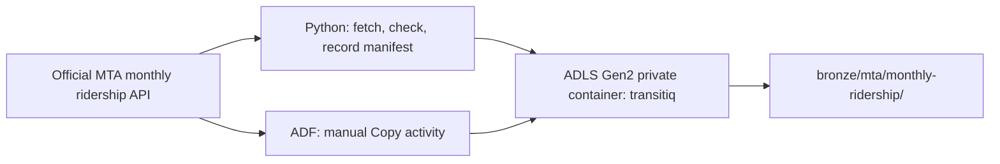

# TransitIQ Level 2: learning Azure ingestion

**What this covers:** Phases 5–8 only, from checking the Azure student account through landing a small MTA response with Python and Azure Data Factory (ADF). This is a study guide for explaining what you built and why. It describes the setup verified by November 1, 2026.

## 1. The idea in one minute

Imagine the MTA publishes a table on the internet. We want to keep a traceable copy of a *small part* of that table in our own cloud storage. Later levels can clean it, calculate metrics, and build the website. Level 2 stops after the copy reaches the **Bronze** area of our data lake.

We tried two independent ways to get the same kind of source data into Bronze:

1. **Python route:** Our script requests MTA rows, checks them, writes a manifest, and uploads the original response to Azure Data Lake Storage Gen2 (ADLS).
2. **ADF route:** ADF makes a bounded HTTP request and copies the returned bytes to ADLS. We inspect its run in ADF Monitor.

ADF did **not** execute our Python script in this exercise. These are two separate hands-on ingestion routes. Their different strengths are explained in [Section 6](#6-python-and-adf-side-by-side).



The verified ADF example used **January–May 2019**, which is 5 months × 4 rail service labels = **20 rows**. That is a teaching sample; it is **not** the whole project's planned 2019–2026 history.

## 2. Phase 5: we checked the Azure account before creating resources

| Question | What we found or did | Why it matters |
| --- | --- | --- |
| Whose account? | Your **student Azure account**, not MTA work credentials. | Keeps this independent portfolio project under your control. |
| Which subscription? | **Azure for Students**. At the account check, it showed **$100 of $100 credit**, October cost **$0**, and expiry **October 31, 2027**. | The credit can pay for eligible Azure use; that snapshot is not a promise of the current balance. |
| Spending goal? | **$0 intended personal spending**. A **$5 monthly budget alert** was set. | The alert tells you to check costs. It does not automatically stop resources. |
| Spending limit? | Its exact portal setting was **not located or independently verified**. | Do not describe the budget alert as a hard spending cap. Check account status before any paid upgrade or larger workloads. |
| Which region? | **East US was rejected** by the student subscription's allowed-location policy. **North Central US** was allowed and used for storage and ADF. | A deployment policy can block a region even if a service exists there. |
| Which resource group? | `rg-transitiq-dev`. | It groups the cloud resources for this development project. A resource group is an organizing boundary, not the data lake itself. |
| Azure SQL? | The portal displayed the **Azure SQL Database free offer**, but no SQL server or database was created in Level 2. | Eligibility was checked; SQL processing has not happened yet. |

**An everyday analogy:** A subscription is the account that pays; the resource group is a labeled project folder; a region is where the cloud resource is deployed. The storage account and Data Factory are actual resources inside that group. Microsoft explains [Azure for Students credit](https://learn.microsoft.com/en-us/azure/education-hub/faq), [budgets](https://learn.microsoft.com/en-us/azure/cost-management-billing/costs/tutorial-acm-create-budgets), and [spending limits](https://learn.microsoft.com/en-us/azure/cost-management-billing/manage/spending-limit) separately.

## 3. Phase 6: we built the data lake

We created storage account **`transitiqdl20263847`** in North Central US. It uses **Standard**, **Hot** access tier, **locally redundant storage (LRS)**, and **hierarchical namespace**. Hierarchical namespace is the setting that gives this storage account ADLS Gen2 file and directory behavior. [Microsoft's ADLS introduction](https://learn.microsoft.com/en-us/azure/storage/blobs/data-lake-storage-introduction) explains that feature.

Inside the account we created one **private file system/container** named `transitiq`. These words refer to the same top-level storage boundary here. Inside *that* container we made directories:

```text
Storage account: transitiqdl20263847
└── File system / container: transitiq
    ├── bronze/       original bounded source responses
    ├── silver/       future typed and checked records
    ├── gold/         future dashboard-ready metrics
    ├── quarantine/   future rejected or ambiguous records
    └── ops/          small operational files and the access test
```

Think of the **storage account** as a building, `transitiq` as one room, and `bronze/` as a shelf inside that room. `bronze` is **not another container**. That distinction caused one of our ADF errors later.

**Bronze/Silver/Gold describe data preparation stages.** In Level 2, only Bronze contains the MTA ingestion examples. The Silver and Gold directories exist to make the future layout clear; no Silver or Gold transformation was completed here. These directories are ordinary ADLS directories, not Delta Lake tables.

We used Microsoft Entra identity-based access. Anonymous blob access and storage account key access were disabled. Your student identity could upload and read a tiny file in `ops/`, proving your own data access. We also gave the **ADF factory's system-assigned managed identity** the **Storage Blob Data Contributor** role for the `transitiq` container, so ADF could write there without a shared storage key. Your user account and ADF are different identities. [Managed identity](https://learn.microsoft.com/en-us/azure/data-factory/data-factory-service-identity) is Azure's way of giving a service its own identity; [container-scoped roles](https://learn.microsoft.com/en-us/azure/storage/blobs/assign-azure-role-data-access) limit where that identity can work.

The account's public network access was enabled for this exercise, but the container was **not anonymous or a public website**. Network reachability and permission to read data are different checks.

For the exact folder, metadata, and retention rules, see [Phase 6 ADLS layout](06_adls_layout.md).

## 4. Phase 7: Python fetched and uploaded a checked sample

The first source was the official [MTA Monthly Ridership / Traffic Data](https://data.ny.gov/d/xfre-bxip), dataset ID **`xfre-bxip`**. One source row gives a published ridership **estimate** for one agency label and one month. Our selected labels were Subway, SIR, LIRR, and MNR. For this source, the published Subway grouping includes SIR, so you must not add the separate SIR row to the Subway figure.

The local program is [monthly_ridership.py](../../src/transitiq/ingestion/monthly_ridership.py). It requested only January–May 2019, used ordered pages, and checked that the result had exactly one row for each selected agency-month. It also checked fields, month labels, numbers, nonnegative values, and duplicates. Five months × four labels gave **20 validated rows**. The script keeps the original response bytes; validation does not rewrite the source values.

It wrote two files in a unique local run folder on **E:**:

| File | Simple meaning | Example contents |
| --- | --- | --- |
| `response.json` | The exact API response for this bounded request. | Rows such as January 2019 LIRR `7166693.19`. |
| `manifest.json` | A small receipt describing the request and saved response. | Source ID, selected months, retrieval time, publisher row-update time, 20-row count, byte count, SHA-256 checksum, and run ID. |

The **source update time** and **our retrieval time** mean different things. In the verified run, MTA's row-update metadata was **October 26, 2026**, while we retrieved the sample on **November 1, 2026**. The update time tells us when the publisher last updated rows; the retrieval time tells us when *we* copied them. A SHA-256 checksum is a fingerprint of the saved bytes: it helps detect an accidental change to the response file.

The upload program [upload_bronze.py](../../src/transitiq/ingestion/upload_bronze.py) checked the local file against its manifest, signed in with the **student** identity, and uploaded `response.json` followed by `manifest.json` to the private ADLS Bronze folder. We ran the same upload again: both files were reported **already present and identical**. It did not overwrite different content at that run path. Each new fetch receives a different run ID, so another fetch makes another folder.

The combined command for this bounded example is:

```powershell
& 'E:\TransitIQ\.venv\Scripts\python.exe' 'E:\TransitIQ\src\transitiq\ingestion\monthly_ridership.py' --start-month 2019-01 --end-month 2019-05 --upload
```

That command ran successfully and uploaded 20 rows. Its verified Python run ID was `20261101T162309Z-410100b3`. The sample and Python environment stayed under `E:\TransitIQ`; the cloud copy stayed in ADLS. Windows and already-installed tools can still use some C: settings or temporary space, so **E: workspace** does not mean literally zero C: activity.

### Reading a Bronze path

```text
transitiq/
  bronze/mta/monthly-ridership/
    source_id=xfre-bxip/
    ingest_date=2026-11-01/
    run_id=20261101T162309Z-410100b3/
      response.json
      manifest.json
```

`source_id` says **which dataset**. `ingest_date` says **when we fetched it**, in UTC. `run_id` identifies **this particular attempt**. The date inside a source row, such as `2019-01-01`, means **the month being measured**. A 2019 observation can therefore live in a folder whose `ingest_date` is 2026; those dates answer different questions.

## 5. Phase 8: ADF made its own small copy

We created **`adf-transitiq-dev-3847`**, a version 2 Azure Data Factory in North Central US. In **Azure Portal**, we created resources and set permissions. In **ADF Studio**, we built the connections, datasets, pipeline, and manual run. This is why you moved between two Azure screens.

### The ADF building blocks

| ADF term | Plain-English meaning | Our example |
| --- | --- | --- |
| **Linked service** | The connection details for a place. | `ls_mta_public_http` points to `https://data.ny.gov/`; `ls_adls_transitiq` points to our storage account using ADF's identity. |
| **Dataset** | Which data inside that place to use. | `ds_mta_monthly_jan2019_http` builds the MTA URL; `ds_adls_bronze_binary` chooses the `transitiq` container, folder, and `response.json`. |
| **Pipeline** | A reusable plan for one or more tasks. | `pl_mta_monthly_jan2019_copy`. |
| **Activity** | One task in that plan. | `copy_mta_monthly_jan2019` performs the Copy. |
| **Integration runtime** | The Azure worker that executes the transfer. | `AutoResolveIntegrationRuntime` handled the cloud-to-cloud Copy. |
| **Parameters** | Values supplied when a run starts. | `start_month` and `end_month`; the sink also receives a unique `folder_path`. |
| **Publish all** | Save the authored ADF definitions for use. | Publishing the dataset or pipeline did not itself copy MTA rows. |
| **Trigger now** | Start one actual pipeline run. | We used manual runs; no schedule was created. |
| **Monitor** | Inspect run status and activity details. | It showed the successful Copy run and its run ID. |

These are standard [ADF linked-service, dataset, pipeline, and activity concepts](https://learn.microsoft.com/en-us/azure/data-factory/concepts-datasets-linked-services). The [Copy activity](https://learn.microsoft.com/en-us/azure/data-factory/copy-activity-overview) performs the actual transfer.

### What happened when we clicked “Trigger now”

1. The pipeline received `start_month=2019-01` and `end_month=2019-05`.
2. The source dataset inserted those values into a **bounded MTA API URL**. The end month was inclusive. The URL selected the four labels and had a **500-row request limit**.
3. The HTTP linked service reached the public MTA endpoint with **Anonymous** authentication. No MTA login or API secret was entered.
4. The Copy activity used **Binary** source and sink formats, so the JSON response was copied as bytes. “Binary” here means **copy the file as-is**, not that the MTA published a mysterious binary data format. [ADF's HTTP connector](https://learn.microsoft.com/en-us/azure/data-factory/connector-http) supports that mode.
5. The ADLS linked service used the **factory's managed identity** to write into `transitiq/bronze/.../response.json`.
6. The destination folder included `run_id=adf-<pipeline-run-id>`, so another manual run would have another folder. ADF Monitor showed **Succeeded**. We opened the saved file and checked all **20 rows**.

The 500-row URL limit bounds the response size; it does **not** prove that every row in an arbitrary requested range arrived. A range with more than 500 matching rows could be truncated. Our checked five-month sample was well below the limit. The Python route performs an explicit expected-row check; this ADF pilot does not.

For example, January 2019 had these four source estimates:

| Source label | January 2019 value |
| --- | ---: |
| Subway | 134,509,588 |
| SIR | 380,333.5 |
| LIRR | 7,166,693.19 |
| MNR | 6,714,443.5 |

The first pilot copied only **January 2019** (four rows), and the manual run in Monitor succeeded. Its pipeline run ID was `a9dc3981-4b8c-4839-9cfb-7c59a437a7b2`. We then connected the start/end parameters and verified a **January–May 2019** copy (20 rows). We used one retry and a 10-minute timeout for the activity. [The Phase 8 record](08_adf_first_pipeline.md) keeps the concise evidence.

### Why we used HTTP and Binary for this first ADF exercise

Our purpose was to prove a direct, small **source → lake** transfer while preserving the source response. The MTA endpoint returns a top-level JSON array. ADF's REST connector has [pagination limits for top-level arrays](https://learn.microsoft.com/en-us/azure/data-factory/connector-rest), so this first exercise used a bounded HTTP request and a Binary copy. The Python path is the one that currently handles page-by-page retrieval and row validation.

## 6. Python and ADF side by side

| Question | Python route | ADF route in Level 2 |
| --- | --- | --- |
| Who made the MTA request? | Python on your laptop. | ADF's Azure integration runtime. |
| Where did the sample land? | First E:, then ADLS Bronze. | Directly in ADLS Bronze. |
| Did it check every selected row? | Yes: schema, valid numbers, expected month-service pairs, duplicates, and bounds. | No: the Copy activity transported bytes; we manually checked the saved sample afterward. |
| Did it write a manifest? | Yes, with source/retrieval timestamps, counts, sizes, and checksum. | No manifest in this pilot; ADF Monitor and the run folder identify the transfer. |
| Did it handle pages? | Yes, with bounded page size and an overall safety limit. | The bounded example fit in one response; no ADF pagination was built. |
| How was Azure accessed? | Interactive student sign-in for the upload. | ADF's managed identity for the ADLS sink. |
| Why learn it? | Practice code-based ingestion, validation, and reproducibility. | Practice Azure orchestration, connectors, parameters, cloud transfer, and monitoring. |

**Interview-ready distinction:** “I used Python for custom validation and a traceable manifest, then separately built an ADF Copy pipeline to learn Azure-native data movement. The ADF pilot did not run my Python code or calculate dashboard metrics.”

## 7. The errors taught us how Azure is organized

| What we saw | What it meant | What fixed it |
| --- | --- | --- |
| East US storage creation was disallowed. | The student subscription had an allowed-region policy. | We deployed in an allowed region, **North Central US**. |
| An IAM screen showed **your** Storage Blob Data Contributor role, but no ADF entry. | A role given to a person does not automatically belong to the factory. | We assigned the ADF managed identity its own role on `transitiq`. |
| Linked-service test tried container `testconnection` and returned Forbidden. | The test used a different container from the one ADF was authorized to access. | We tested an existing file path inside `transitiq`; the connection succeeded. |
| Copy failed with `CreateFile` Forbidden on container `bronze`. | `bronze` had been entered as a **file system**, but it is a directory. | Set **File system = `transitiq`** and put `bronze/...` in **Directory**. The next run succeeded. |
| `00:05:00` was rejected for the activity timeout. | The ADF field required `D.HH:MM:SS` and at least 10 minutes. | We used `0.00:10:00`. |
| The first Python upload returned `PathNotFound`. | The upload call attempted to append before the remote file had been created. | The uploader was changed to conditionally create the file, then read it back. A repeat run reported identical files. |

The two **Forbidden** errors had different causes: one was a connection test outside the authorized container, and one was an incorrect destination container. A 403 error alone does not tell you whether the identity, path, or network is wrong; the **container name and operation** in the detailed error helped us decide.

## 8. What we can honestly say we achieved

- We set up an Azure for Students project resource group, ADLS Gen2 storage account, private container, cost alert, and ADF factory in an allowed region.
- We used identities and a container-scoped data role to let ADF write without a storage key.
- We ingested a bounded official MTA sample through Python, validated 20 rows, recorded source/retrieval metadata and a checksum, and uploaded it to Bronze.
- We built a parameterized, manually triggered ADF Copy pipeline and verified a second 20-row Bronze response in ADLS.
- We used ADF Monitor and detailed errors to diagnose two permission/path problems.

**The boundary of Level 2:** no Silver transformation, Gold metric, Azure SQL table, Databricks job, schedule, or website was produced by these steps. The ADF pilot did not perform the Python validation or create a manifest. The $5 budget alert is a notification, not a hard stop. These limits make the interview explanation more accurate.

## 9. A short interview answer

> “I built the ingestion foundation for an MTA rail analytics project using Azure for Students. I created an ADLS Gen2 storage account with a private container and Bronze folders, then used a Python script to fetch and validate a bounded monthly ridership sample and upload it with a manifest. Separately, I created an Azure Data Factory pipeline with an anonymous HTTP source, a managed-identity ADLS destination, date parameters, and a manual Copy activity. I verified a 20-row January–May 2019 response in the lake and used ADF Monitor to check the run. The main lesson was how Azure identities, containers, directories, datasets, and pipeline activities fit together.”

### Questions you may get

| Interview question | A clear answer |
| --- | --- |
| Why both Python and ADF? | Python let me write detailed source checks and a manifest. ADF let me practice Azure's connectors, parameters, Copy activity, and run monitoring. They were separate pilot paths. |
| What is ADLS Gen2 here? | The storage account has hierarchical namespace enabled. The private `transitiq` file system holds directories such as `bronze/`. |
| What is the difference between a linked service and dataset? | A linked service says *how to reach* a source or destination. A dataset says *which URL or file path* to use there. |
| Why did ADF need its own role? | It runs as its own managed identity. My student account's storage permission did not transfer to it. |
| Why preserve Bronze? | It gives later processing a traceable source response. The Python manifest adds request details and a checksum. |
| Is the dashboard using ADF live? | No. Level 2 only stored source data; the public dashboard and prepared outputs are later work. |
| What did the successful Copy prove? | The configured ADF source, integration runtime, identity, and ADLS destination worked together for a bounded sample. It did not prove all historical rows or business metrics are correct. |

## 10. Quick glossary

| Word | Meaning in this project |
| --- | --- |
| **Ingestion** | Bringing selected source data into our project storage. |
| **ADLS Gen2** | Azure storage with hierarchical namespace, used as the data lake. |
| **Bronze** | The area for original bounded source responses. |
| **Resource group** | Azure's project grouping for resources. |
| **Container / file system** | The top-level private storage area named `transitiq`. |
| **Directory** | A folder *inside* that area, such as `bronze/`. |
| **Managed identity** | The factory's Azure identity for accessing storage without a shared key. |
| **RBAC role** | Permission granted to an identity at a chosen scope. |
| **Manifest** | A receipt describing one Python ingestion run and its file. |
| **Run ID** | An identifier for one execution, used in monitoring and folder names. |
| **Binary copy** | Copy the source response as bytes, without parsing or transforming rows. |
| **Parameter** | A value, such as a month, supplied to a reusable pipeline or dataset. |

